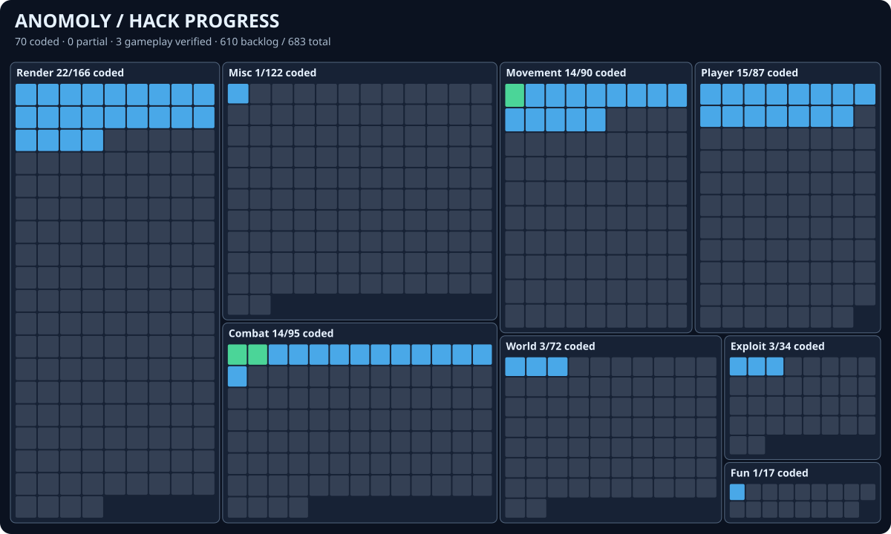

# Anomoly

Anomoly is a full Minecraft Java 26.3 hacked client built as a Fabric mod, with an ImGui ClickGUI, modules, configuration, and passive anticheat profiling. Module coverage is expanding. The [cheat catalog](cheats/README.md) and source audit support implementation; the treemap below shows what is currently coded and tested.

## Hack progress

[](https://distilledslop.github.io/anomoly/progress.html)

The [searchable progress report](https://distilledslop.github.io/anomoly/progress.html) is generated from the 682 catalog entries plus Anomoly's Spear Assist. It currently tracks <!-- anomoly-progress:start -->**47 coded**, **3 partial**, **0 gameplay verified**, and **633 backlog**<!-- anomoly-progress:end --> features. Blue tiles are coded modules, amber tiles are partial implementations, green tiles have gameplay test evidence, and gray tiles are backlog. Run `python3 tools/progress.py` after changing a module's status; CI runs `python3 tools/progress.py --check` to verify the treemap and [raw data](docs/progress.json).

## Build and run

Use Java 25 and run `./gradlew build`. The distributable is `build/libs/anomoly-1.0.0.jar`; it includes ImGui Java and native libraries for Windows, Linux, and macOS. Install it with Fabric Loader 0.20.1 and Fabric API 0.165.0+26.3.

The Dear ImGui ClickGUI uses the OpenGL backend. Choose **OpenGL** in Minecraft's video settings before starting the game, or launch with `--graphicsBackend opengl`. On Vulkan, Anomoly opens a functional native settings screen with the same modules and profile controls. Right Shift opens or closes the GUI, and End disables every module. Both keys appear in Minecraft's key controls.

The ClickGUI has a category sidebar, module search, expandable settings, and a server profile page.

## Implemented modules

| Category | Modules |
| --- | --- |
| Combat | Auto Weapon, Auto Sword, Auto Clicker, Trigger Bot, Kill Aura, Spear Assist, Reach, Auto Armor, Auto Bow Release, Auto GApple, Auto Totem |
| Movement | Auto Sprint, Auto Walk, Auto Jump, Auto Sneak, Fast Ladder, Fast Fall, No Fall, Safe Walk, Step, Anti Web, No Slow (partial) |
| Player | Auto Respawn, Auto Eat, Auto Fish, Anti AFK, Auto Tool, Auto Replenish, Auto Deposit, Auto Drop (also Auto Eject), Chest Stealer, Chest Cleaner |
| World | Fast Place, Fast Break (also Break Delay) |
| Render | Max Brightness, No Hurt Cam, No Bob, Auto F5, FOV Modifier, No FOV, No Overlay, No Fire Overlay, Anti Overlay, Player Radar |
| Exploit | Anti Reduced Debug Info, Portal Menu |
| Fun | Twerk |

Modules default to off. Their states and settings are saved in `config/anomoly.json`. The current Kill Aura defaults to visible targets within three blocks and full attack cooldown; its range and other settings are adjustable in the GUI. Server anticheats can reject or punish module behavior, so the passive profiler makes no guarantee of compatibility.

Chest Stealer, Chest Cleaner, Auto Deposit, and Auto Drop accept comma-separated item IDs such as `minecraft:rotten_flesh`. Chest Stealer skips items selected for cleaning or depositing when those modules are enabled.

## Passive anticheat profile

The profiler is on by default. Each joined session creates a JSONL log in `config/anomoly/profiles/`. It records the server brand, observed custom payload channel names, one movement sample per second, latency, position corrections, active module names, and the disconnect reason. It sends no test packets or plugin enumeration requests. This means it can show behavioral evidence but may not identify the exact anticheat plugin.

After a session, run:

```sh
python3 research/analyze_anomoly_profile.py config/anomoly/profiles/<session>.jsonl
```

The analyzer separates initial join corrections from later ones and reports correction rates by module exposure, observed channels, and disconnect details. Module rates overlap when several modules are enabled, so they are signals for controlled testing rather than proof of cause. Review the raw log before sharing it: it contains server addresses and player coordinates.

## Research

See [RESEARCH.md](RESEARCH.md), [hacks](hacks/README.md), and [exploits](exploits/README.md) for 26.3 source findings and feature designs. Their claims describe vanilla behavior in local probes; compatibility with a remote anticheat requires evidence from a real session.
