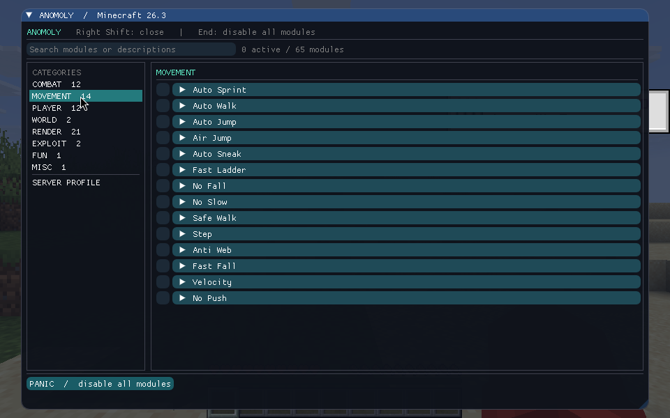

# Anomoly

Anomoly is a full Minecraft Java 26.3 Fabric hacked client. Its working Dear ImGui ClickGUI controls combat, movement, player, world, render, exploit, and utility hacks, with keybinds and saved settings. Built-in anticheat profiling records what a server exposes and how it responds during play. The hack catalog is under active development; the treemap below shows what is implemented and gameplay tested.

## Hack progress

[](https://distilledslop.github.io/anomoly/progress.html)

The [searchable progress report](https://distilledslop.github.io/anomoly/progress.html) is generated from the 682 catalog entries plus Anomoly's Spear Assist. It currently tracks <!-- anomoly-progress:start -->**347 coded**, **24 partial**, **84 gameplay verified**, and **228 backlog**<!-- anomoly-progress:end --> features. Blue tiles are coded modules, amber tiles are partial implementations, green tiles have gameplay test evidence, and gray tiles are backlog. Run `python3 tools/progress.py` after changing a module's status; CI runs `python3 tools/progress.py --check` to verify the treemap and [raw data](docs/progress.json).

## Build and run

Use Java 25 and run `./gradlew build`. The distributable is `build/libs/anomoly-1.0.0.jar`; it includes ImGui Java and native libraries for Windows, Linux, and macOS. Install it with Fabric Loader 0.20.1 and Fabric API 0.165.0+26.3.

The Dear ImGui ClickGUI uses the OpenGL backend. Choose **OpenGL** in Minecraft's video settings before starting the game, or launch with `--graphicsBackend opengl`. On Vulkan, Anomoly opens a functional native settings screen with the same modules and profile controls. Right Shift opens or closes the GUI, End disables every module, C holds Zoom, and H holds Free Look when those modules are enabled. These keys appear in Minecraft's key controls.

Every module also has an optional toggle key under **Minecraft Controls → Anomoly Modules**. They start unbound; assign a key in Controls, then use it in the world to toggle the module or trigger a one-shot module such as Pot. An expanded module in the ImGui ClickGUI shows its current key. The key mappings are saved by Minecraft in `options.txt`, while module states and settings remain in Anomoly's config. A [local input test](docs/test-evidence/2026-10-30-module-keys.md) confirms a bound Pot key performed the one-shot action.

The ClickGUI has a category sidebar, module search, expandable settings, and a server profile page. Player Radar also shows nearby loaded players on the HUD with relative direction and distance.



The [local gameplay test](docs/test-evidence/2026-10-30-local-gameplay.md) verifies Auto Walk movement, Aimbot and Aim Assist rotation, No Rotate against both server rotation paths, the panic key, ClickGUI rendering and input, and passive profile collection in a Minecraft 26.3 multiplayer world.

## Implemented modules

| Category | Modules |
| --- | --- |
| Combat | Auto Pearl, Auto Soup, Soup, Keep Sprint, Sprint Reset, W Tap, Criticals, Surround, Hole Filler, Self Trap, Self Web, Self Anvil, Anti Anvil, Anti Bed, Auto Anvil, Auto Trap, Auto Dodge, Auto Crystal Base, Crystal Aura, Anchor Aura, Bed Aura, Super Knockback (partial), Auto Weapon, Auto Sword, Auto Clicker, Trigger Bot, Anti Bot, Kill Aura, Aimbot, Aim Assist, Bow Aimbot, Projectile Aimbot, Auto Shoot, Auto Bow, Bow Spam, Auto Rod, Spear Assist, Reach, Auto Leave, Auto Armor, Auto Bow Release, Auto Potion, Throw Pot, Pot, Auto Exp, Auto GApple, Auto Totem, Hitbox, FakeLag, MultiAura, ClickAura, AntiLegitMiss, PvpInfo, FeedAura, Auto City, FightBot, MaceKill (also MaceDmg), ArrowDmg (also BowPop), TpAura, SelfFill (also Burrow), Quiver |
| Movement | Auto Sprint, Auto Walk, Auto Jump, NoJumpDelay, Auto Swim, Air Jump, Auto Sneak, GUI Move (also Inventory Move), AntiBounce, BlockBounce, Parkour, HighJump, ReverseStep, Fast Ladder, Fast Fall, No Fall, Safe Walk, Step, Anti Web / NoWeb (partial), Velocity, No Push (also AntiWaterPush), No Slow, Fly, Glide, Jetpack, Speed, BunnyHop, Strafe, Spider, Jesus (also LiquidWalk), Dolphin, FastSwim (also WaterSpeed), Freeze, LongJump, AntiVoid, AntiLevitation, IceSpeed, Yaw, ElytraFly (also Elytra Boost), ElytraRecast, EntitySpeed (also VehicleBoost), BoatFly, Levitation Control (also LevitCtrl), Follow, SnowShoe, AvoidHazards (also Anti Hazard), HoleSnap (also AutoHole, HoleAnchor), Clip, ClickTp, SnapTap, TargetStrafe, Fish, NoClip, FastAccel, TridentFly (partial: TridentBoost, TridentTweaks), PacketFly (partial: Phase) |
| Player | Auto Respawn, Auto Eat, SmartEat, FastExp, Auto Fish, Auto Mend, Offhand, Eagle, Elytra Swap, Auto Buff, NoBlockInteract, NoEntityInteract, No Interact, LiquidInteract, Fast Interact, Auto Crafter, Inventory Cleaner, Anti AFK, Auto Break (also Auto Mine), Durability Alert, Auto Switch, Auto Tool, Auto Replenish, Auto Deposit, Auto Drop (also Auto Eject), Chest Stealer, Chest Cleaner, No Rotate (also No Server Rotate), Blink, NoServerSlot (also NoSlotSet), RotationLock (also ViewLock), ToolSaver (also Item Saver), AutoReply, XCarry, No Status Effects (also AntiBadEffects), Fake Player, NoEntityTrace (also No Mining Trace), Multitask, PotionSpoof, ElytraReplace, AntiAttack, AutoWindCharge |
| World | Fast Place, Fast Break (also Break Delay), AirPlace, AntiInteract, Auto Brewer, AutoBuild, Auto Smelter, Scaffold, Nuker, Nuker Legit, Vein Miner, Auto Tunnel (also Tunneller), Auto Shearer, Auto Breed, Auto Mob Heal, Auto Farm, Auto Mount, Auto Nametag, Enderman Look, Timer, Tillaura, BonemealAura, LiquidFiller, Stash Finder (also StashLogger), Gamemode, Spawn Proofer, Extinguish, AutoDisable, ProjectilePuncher, NoSlowBreak (partial) |
| Render | Fullbright, Max Brightness, No Hurt Cam, No Bob, Auto F5, FOV Modifier, No FOV, Zoom, Camera Clip, Camera Tweaks, Free Look, No Fog, No Overlay, No Fire Overlay, Anti Overlay, Anti Wobble, No Pumpkin, Anti Blind, Player Radar, Weather Changer, Time Changer, WaterMark, FpsCounter, PingHud, MemoryHud, Coords, Speedometer, ModuleList, PotionHud, ArmorHud, TotemCounter, GapplesHud, PlayerEsp, MobEsp, ItemESP, ESP (also Wall Hack), TrueSight, NoSwing, StorageESP, BarrierEsp, PortalEsp, BlockESP (also Search), Light Overlay (also MobSpawnEsp), Tracers, Breadcrumbs (also Trail, Trails), RangeCircle, TNTTimer, HealthTags, KeyBinds, TargetHud, JumpCircle (also JumpEffect), ItemTags, Entity Owner (also MobOwners), No Render (also Particles), NoVignette, Waypoints (also Marker), LogoutSpots (also LogoffSpot), HoleESP, TPSCounter, LagNotifier (also LagDetector), FreeCam, Hitmarkers, HitParticles (also HitFX, HitBubbles, DamageParticles), KillEffect, XRay, ExtraTooltips (also Better Tooltips, Tooltips), MurderMystery, KillStats, City Esp, InventoryInfo, TimerIndicator, Trajectories, BlockOutline (also BlockHighLight, Block Selection), Break Indicators (also BreakESP, BreakHighLight), CrosshairArrows, DamageTint, LagReducer (also UnfocusedFPS), Borders, ChestCounter, Cooldowns, PVPResources, LegacyHud, VoidESP, SoundESP, BedPlates, Hats, Skeleton, Nametags, Crosshair, KillFeed, Pop Chams, ExtraTab (also BetterTab), CandleHud, Companion, Hotbar, HUD, StaffBoard, RadarRewrite, Debug, TotemEffect, QuickPerspectiveSwap |
| Exploit | Anti Reduced Debug Info, Portal Menu, Plugins, PingSpoof, AbortBreaking, NameCollector, AntiHunger (partial), Damage |
| Fun | Twerk (also MileyCyrus), Derp, HeadRoll, Tired, Skin Blinker (also SkinDerp), Vomit, HandDerp, Lsd (also RainbowUi) |
| Misc | Auto Reconnect, AntiCheat Detect, Spammer (also Spam), Greeter, Announcer, Packet Canceller (also AntiPacket), Timestamps, AntiSpam, ChatAppend (also MessageAppend), GreenText, AutoAccept, VisualRange, TotemPopCounter, AutoEZ, MiddleClick (also MiddleClickAction), Anti Aim, Log Position, Sound Blocker, ChatColors, Fancy Chat, Notifier, FlagCheck, PacketLogger, ChestAura, Panic (also Self Destruct), Message Aura, No SRP (also AntiServerRP), AutoAuth (also AutoAccount), GUICloser, NameProtect, ClientSpoof (partial: Server Spoof), Teams, Middle Click Friend, TargetLock, AutoFlyme, AntiStaff |

Modules default to off. Their states and settings are saved in `config/anomoly.json`. The current Kill Aura defaults to visible targets within three blocks and full attack cooldown; its range and other settings are adjustable in the GUI. Server anticheats can reject or punish module behavior, so the passive profiler makes no guarantee of compatibility.

Auto Swim enters the swimming pose when moving forward underwater, while leaving normal surface movement alone. A [paired local gameplay test](docs/test-evidence/2026-10-30-autoswim.md) confirmed the server's swimming flag with the module enabled and its absence with the module disabled.

NoJumpDelay removes the local ten-tick gate between ground jumps while jump is held. In a two-block-high local test corridor, the server counted 8 jumps in four seconds with the module off, 28 with it on, and 8 after switching it off again. It does not add midair jumps. See the [paired gameplay test](docs/test-evidence/2026-10-30-nojumpdelay.md).

AntiBounce keeps the local player grounded after landing on a springy block. In a [paired slime-block test](docs/test-evidence/2026-10-30-antibounce.md), the server saw rebounds with the module off, a stable landing with it on, and rebounds again after disabling it.

BlockBounce adds configurable upward motion to a grounded jump from slime, honey, or a bed. In [local server tests](docs/test-evidence/2026-10-30-blockbounce.md), a slime jump rose substantially higher with it enabled, honey and bed jumps received the boost, and a stone jump stayed at ordinary height.

Parkour jumps when the next step would leave the current block. In [local server tests](docs/test-evidence/2026-10-30-parkour.md), it jumped at the edge, crossed a one-block gap, and kept ordinary walking flat on continuous ground.

HighJump sets the upward launch strength of a normal jump. Its Vanilla and Vulcan modes share a configurable motion value; Vulcan mode has an optional descent glide. [Local server tests](docs/test-evidence/2026-10-30-highjump.md) confirm the stronger launch and glide behavior. Anticheat evasion remains untested.

ReverseStep speeds up nearby drops through Instant, Strict, or Accelerator mode. It avoids known hazardous landings and deliberately started jumps, and it limits activation to a configurable fall distance. Its gradual Instant option spreads movement across client ticks so Minecraft sends its normal position packets. [Per-tick local tests](docs/test-evidence/2026-10-30-reversestep.md) cover all three modes and three guards.

No Push can suppress entity collision pushes and water or lava currents separately. Its fluid setting also covers AntiWaterPush. In a [paired water-current test](docs/test-evidence/2026-10-30-waterpush.md), the server saw the player drift about 2.4 blocks with No Push off and remain at the starting position with it on.

GUI Move forwards your configured movement keys while an inventory or container screen is open. It can pass through jump, sprint, and sneak separately, rotate the view with arrow keys, or cover other non-text screens. Chat, text editors, and the ClickGUI keep their normal typing behavior. The [paired local gameplay test](docs/test-evidence/2026-10-30-guimove.md) confirms movement with inventory and chest screens open, jumping, view rotation, a rebound forward key, a chat guard, and a disabled-module control.

Auto Mend rotates damaged Mending gear through the offhand as XP repairs it. It protects another offhand item by default, can optionally replace and later restore that item, and can exclude item IDs. The [local gameplay test](docs/test-evidence/2026-10-30-automend.md) confirms a two-tool repair cycle using real XP orbs, a totem guard, blacklist handling, and totem restoration.

Offhand equips a totem during low health, dangerous falls, or nearby crystal and primed creeper threats, then restores the item it displaced when danger clears. Its automatic mode can equip crystals for Crystal Aura, strength potions or golden apples while using a sword with Kill Aura, and solid building blocks for Scaffold or Eagle. You can also choose Totem, Crystal, Gapple, Strength, or Block directly, or bind separate mode and cycle keys in Minecraft Controls. Auto Totem and Auto Mend take priority when enabled; Inventory Cleaner leaves the offhand to this module. The [local gameplay test](docs/test-evidence/2026-10-30-offhand.md) covers inventory swaps, manual keys, emergency restoration, automatic combat selection, and the crystal fallback.

Eagle uses normal sneak input near unsupported block edges for manual bridging. You can set a randomized edge distance and require ground contact, held blocks, movement keys, or a look pitch range. Its [local gameplay test](docs/test-evidence/2026-10-30-eagle.md) confirms server observed crouching at an edge, release at the block center, a two-second forward walk stopped before a fall, and automatic Offhand block selection while Eagle is enabled.

Elytra Swap switches a chestplate and usable elytra in one bound key press, using the hotbar, main inventory, or offhand. It rejects nearly broken wings and a chestplate with Binding Curse, remembers the displaced chestplate for the return swap, and chooses the strongest available chestplate if that item is gone. The module disables itself after each action or when you disconnect. The [local gameplay test](docs/test-evidence/2026-10-30-elytraswap.md) covers both swap directions, offhand sources, worn-wing and curse controls, an empty chest slot, and chestplate scoring.

Auto Buff uses configured soups, edible player heads, golden apples, and beneficial splash or drinkable potions when health or effects call for them. It filters harmful potions, can refill empty hotbar slots or temporarily swap a main-inventory item into a full hotbar, and restores the selected item after use. Ground distance and nearby-player guards are available for splashes, with optional combat pause settings. The [local gameplay test](docs/test-evidence/2026-10-30-autobuff.md) confirms healing and effect potions, apples, soup, a custom edible head, poison rejection, refill, and full-hotbar restoration.

FastExp throws experience bottles while its dedicated key is held. Bind **Hold Anomoly FastExp** under Minecraft Controls, then enable the module in the ClickGUI. Normal and Fast throw modes, Mending-only NoWaste thresholds, downward aim, combat pause, and delayed hotbar restoration are configurable. It can use bottles from the hotbar or offhand and turns itself off when disconnected. The [local gameplay test](docs/test-evidence/2026-10-30-fastexp.md) covers helmet and held-tool repair, the no-Mending guard, fast-mode bursts, NoWaste in both modes, slot restoration, and disconnect cleanup.

NoBlockInteract routes a right-click on a container or common interactive block to a usable held item, so food or other active items can be used while aiming at the block. Sneaking retains the normal block interaction. NoEntityInteract filters right-clicks by entity type and main-hand item; its default settings suppress empty-hand, shears, TNT, bucket, cobweb, and mining-tool interactions with villagers and armor stands. Both modules act on manual right-clicks and leave automatic module interactions alone. The [paired local gameplay test](docs/test-evidence/2026-10-30-interactions.md) covers a chest and golden apple, a villager and empty hand, and an iron-sword control.

No Interact has independent filters for mining blocks, using blocks, hitting entities, and using entities. Each filter accepts comma-separated IDs and a blacklist or whitelist mode. Block and entity use can be blocked by hand; named entities, baby animals, and player names can be protected from hits, use, or both. The [local gameplay test](docs/test-evidence/2026-10-30-nointeract.md) covers every action guard, list inversion, hand selection, baby animals, and named entities.

LiquidInteract includes fluid surfaces in the player's normal block-target raycast. In a [paired local gameplay test](docs/test-evidence/2026-10-30-liquidinteract.md), a dirt click with the module on replaced a water source, while the same click with it off placed dirt against the stone behind the water.

Fast Interact has separate switches and tick intervals for block placement, block-break delay, and discrete item use. It uses the normal client input path and leaves item consumption duration alone. A [paired local gameplay test](docs/test-evidence/2026-10-30-fastinteract.md) measured all three default branches against disabled controls.

SmartEat automatically chooses the most nourishing safe food from the hotbar, offhand, or main inventory when hunger drops below its threshold. At low health it prioritizes enchanted apples, golden apples, and drinkable healing potions. Right-clicking with a tool temporarily uses a chosen food from the offhand without changing the selected hotbar slot; a ghost slot beside the hotbar previews that food. It restores any item displaced from the offhand and can pause its own eating during combat or briefly pause Anomoly's automated attacks after use. The [local gameplay test](docs/test-evidence/2026-10-30-smarteat.md) covers food ranking, low-health priorities, manual and automatic eating, harmful-food rejection, and inventory restoration.

Auto Crafter makes listed Recipe Book outputs in an open inventory, crafting table, furnace, blast furnace, or smoker screen while the Recipe Book panel is visible. It supports ordered targets, stack crafting, configurable action delays and containers, and four full-inventory responses. Cooking machines need fuel loaded. The [local gameplay test](docs/test-evidence/2026-10-30-autocrafter.md) confirms all five screen types, every full-inventory response, and recipe-order loop prevention.

Inventory Cleaner sorts configured item categories or IDs into hotbar slots, can place an item category in the offhand, merges partial stacks, and discards blacklisted or non-whitelisted items. Quantity caps cover blocks, arrows, throwables, food points, and buckets. It runs with the inventory closed or open and can optionally act while a container is open. The [local gameplay test](docs/test-evidence/2026-10-30-inventorycleaner.md) confirms hotbar sorting, better-item replacement, stack merging, full-stack drops, a partial-stack cap, whitelist filtering, offhand placement, and open-inventory operation.

Scaffold places full blocks under and ahead of a walking player, drawing from the offhand or hotbar and restoring the selected slot. Its default edge guard stops movement when there is no block to stand on; Safe Walk exposes that guard independently. Optional tower mode jumps in place and builds upward. The [local gameplay test](docs/test-evidence/2026-10-30-scaffold.md) records a continuous 19-block bridge, stops at both empty edges, offhand placement, sand rejection, a four-block tower, and a separate Safe Walk run. The optional visible-face check is off by default; strict server anticheats may reject placements without it.

AirPlace changes a right-click aimed at empty space into an ordinary block-use interaction at the aimed position. It handles blocks, spawn eggs, armor stands, and firework rockets from either hand, with an optional fixed range. The [local gameplay test](docs/test-evidence/2026-10-30-airplace.md) confirms all four item types, offhand placement, normal block-click behavior, a water guard, and fixed range on a vanilla 26.3 server.

AntiInteract prevents right-clicking a configurable list of containers. Sneaking with an item can still place against one. The [local gameplay test](docs/test-evidence/2026-10-30-antiinteract.md) confirms chest, barrel, and colored shulker protection, an unlisted crafting-table control, and sneak placement.

Auto Brewer makes a configured vanilla potion while a brewing stand is open. It fills the stand from inventory, supplies fuel and the next ingredient, waits for each brew, and returns finished bottles. The [local gameplay test](docs/test-evidence/2026-10-30-autobrewer.md) confirms three strength potions, splash and lingering weakness, partial-batch resume, unrelated-potion protection, and ingredient remainder cleanup.

AutoBuild constructs a stone platform or a lit nether portal from hotbar or offhand materials, then turns itself off. It can filter platform blocks, limit reach and placement speed, and require visible support faces. The [local gameplay test](docs/test-evidence/2026-10-30-autobuild.md) confirms a complete 5×5 platform, a lit portal, hotbar restoration, and a missing-material guard.

Auto Smelter fills an open furnace, blast furnace, or smoker with configured inputs and fuel, collects cooked results, and can close the menu or turn itself off when finished. The [local gameplay test](docs/test-evidence/2026-10-30-autosmelter.md) confirms iron, gold, and beef processing; a missing-fuel guard; a two-coal refill; and the completion options.

Nuker mines nearby blocks one at a time with ordinary mining actions. Its block-ID list can act as a whitelist or blacklist; it can select a suitable hotbar tool, keep the block under your feet, and skip block entities. Nuker Legit uses the same mining path but requires a visible block within its field of view and turns the crosshair onto its face before mining. The [local gameplay test](docs/test-evidence/2026-10-30-nuker.md) confirms three automatic dirt breaks, tool use and slot restoration, floor and filter controls, an occluded target, and a field-of-view control. These settings do not guarantee compatibility with a server anticheat.

Vein Miner starts when you break an ore or log and continues through connected blocks of the same type. It can include additional block IDs or every type, connect diagonal blocks, cap the vein size, and preserve the block under your feet. The [local gameplay test](docs/test-evidence/2026-10-30-veinminer.md) confirms a four-ore chain, a disconnected-ore control, no work without a click, and a two-block queue limit.

Auto Tunnel mines and walks through a corridor of configurable width, height, and length. It can repair missing floor blocks, place torches at an interval, and pause near fluids, falling blocks, or protected block entities. The [local gameplay test](docs/test-evidence/2026-10-30-autotunnel.md) confirms a three-block 2×2 tunnel, floor repair, hazard pauses, recovery, and torch placement. No automated tunneling is guaranteed safe on every server or terrain.

Auto Shearer finds adult sheep in reach, checks line of sight by default, and uses shears from the selected slot, another hotbar slot, or the offhand. Its [local gameplay test](docs/test-evidence/2026-10-30-autoshearer.md) confirms hotbar and offhand shearing, slot restoration, and controls for babies, walls, and missing shears.

Auto Breed feeds reachable pairs of selected adult animals with their vanilla breeding food. It requires enough food for both and remembers recent feeds to avoid repeatedly using food on the same animal. The [local gameplay test](docs/test-evidence/2026-10-30-autobreed.md) confirms newborn sheep and cows from hotbar and offhand wheat, slot restoration, and a one-wheat control.

Auto Mob Heal repairs injured iron golems with ingots and feeds injured owned pets and tamed mounts with their healing food. It uses normal entity interactions, checks line of sight, and restores the selected hotbar slot. The [local gameplay test](docs/test-evidence/2026-10-30-automobheal.md) confirms golem, horse, wolf, and cat healing, an ownership guard, a wall guard, and a minimum missing-health control.

Auto Farm harvests mature field crops, nether wart, cocoa, melons, pumpkins, berries, and the upper growth of cane, cactus, bamboo, and kelp. It replants harvested crops and empty farmland, with optional bone meal for immature crops. The [local gameplay test](docs/test-evidence/2026-10-30-autofarm.md) covers every listed plant type, a bone meal run, and a line-of-sight control.

Auto Mount boards nearby rideable animals, boats, rafts, and passenger minecarts with ordinary entity interactions. It can require a tamed mount, a saddle, an empty hand, and line of sight. The [local gameplay test](docs/test-evidence/2026-10-30-automount.md) covers eight rideable types and checks the saddle, visibility, occupancy, and hand guards.

Auto Nametag uses named tags from either hand or the hotbar on every nearby unnamed living entity it can reach. The [local gameplay test](docs/test-evidence/2026-10-30-autonametag.md) confirms multiple targets, name preservation, tag consumption, offhand use, slot restoration, and a line-of-sight control.

Enderman Look can turn toward a visible enderman or turn away when the player's gaze reaches its eyes. Its [local gameplay test](docs/test-evidence/2026-10-30-endermanlook.md) confirms both modes and a wall control.

Aimbot turns toward the visible entity closest to your crosshair within its configured range and field of view. Aim Assist makes smaller corrections while you hold attack. Both default to player targets, can optionally include mobs or invisible entities, and yield to Kill Aura when it is enabled. Neither module attacks on its own.

Bow Aimbot and Projectile Aimbot calculate aim using Minecraft 26.3 projectile flight physics, including drag, gravity, bow charge, target movement, and terrain collision. They never fire for you. The [projectile aim gameplay test](docs/test-evidence/2026-10-30-projectile-aim.md) records bow and crossbow hits at about 16 blocks and a snowball hit on a blaze at about 12 blocks; other weapon modes need separate gameplay tests.

Auto Shoot uses that same solver to select, aim, and throw eggs or snowballs at a controlled rate. It can select a projectile from the hotbar and restore your previous slot. A [local gameplay test](docs/test-evidence/2026-10-30-autoshoot.md) confirms it killed a stationary blaze without manual input after setup.

Auto Bow selects, aims, charges, and fires bows, crossbows, and tridents using normal item interactions. It can shorten bow charge for faster, weaker shots, select a weapon from the hotbar, and restore the previous slot. A [local gameplay test](docs/test-evidence/2026-10-30-autobow.md) confirms automatic hits with all three weapon types. Riptide tridents are excluded because they launch the player instead of a projectile.

Bow Spam repeatedly releases a bow or crossbow while use is held. Its bow charge setting controls the tradeoff between shot rate and power, while crossbows wait for the 26.3 charge duration. A [local gameplay test](docs/test-evidence/2026-10-30-bowspam.md) confirms repeated bow and crossbow shots.

Auto Exp throws experience bottles at your feet when equipped Mending armor or a held Mending tool needs repair. It stops at the configured durability threshold and can select bottles from the hotbar or use them from the offhand. The [local gameplay test](docs/test-evidence/2026-10-30-autoexp.md) confirms armor and tool repair and a no-Mending control.

Auto Potion, which also covers AutoPot, checks potion effects and throws only instant-health splash potions when health is low. Throw Pot is a separate one-shot toggle: it throws one potion, or two below its lower health threshold. Both restore the previous hotbar slot. [Local gameplay tests](docs/test-evidence/2026-10-30-potions.md) confirm healing, the one- and two-potion modes, and rejection of harming potions.

Pot is a separate one-shot hotbar swap for any splash or lingering potion. It throws at the current view direction and restores the previous slot. A [local gameplay test](docs/test-evidence/2026-10-30-pot.md) confirms both potion types and a poison splash potion.

Auto Rod solves the fishing hook's 26.3 flight path, selects a rod, casts at a visible target, reels when it hooks or times out, and restores the previous slot. The [local gameplay test](docs/test-evidence/2026-10-30-autorod.md) confirms repeated hook-and-reel cycles against a stationary pig. It keeps the rod selected while a hook is active because the server removes the hook if neither hand holds a rod.

Auto Pearl watches pearls thrown by other players, simulates their landing, and searches for a throw angle that lands within the configured error margin. It uses a normal item interaction, limits turn speed, and can select a pearl from the hotbar before restoring the previous slot. A [local two-player gameplay test](docs/test-evidence/2026-10-30-autopearl.md) records a landing about 1.4 blocks from the other player.

Auto Soup selects and uses mushroom stew when health is low; Soup is a one-shot toggle that uses one stew regardless of health. Both wait for the item to finish consuming, restore the previous hotbar slot, and can optionally use rabbit or beetroot stew. The [local gameplay test](docs/test-evidence/2026-10-30-soup.md) confirms both consumed stew and restored the slot. Vanilla stew restores hunger, not health. Auto Soup also sends the normal use interaction at full hunger for servers with instant soup healing, but that plugin behavior has not been tested.

Keep Sprint preserves local horizontal movement and restores server sprint state after a sprint attack. Sprint Reset restarts sprint after a player hit when forward movement continues. Super Knockback primes sprint before a full-strength hit, including from a standstill. A [paired two-player test](docs/test-evidence/2026-10-30-sprint-combat.md) confirms sprint state restoration and the increased target displacement. Super Knockback remains partial: the vanilla server rejects damage and extra knockback during its damage cooldown when the new hit is no stronger than the previous one.

W Tap briefly releases forward movement after a full-strength player hit, stops sprint, then resumes both if the forward key remains physically held. Its release duration and minimum interval are configurable. A [paired two-player test](docs/test-evidence/2026-10-30-wtap.md) confirms the server-observed sprint stop and restart and reduced movement during the tap. W Tap takes priority over Keep Sprint and Sprint Reset during that hit.

Criticals defers a melee hit until the player descends from an ordinary jump, then sends the normal attack and swing packets. It falls back to a normal hit when there is no headroom and cancels a delayed hit if the target, held item, or world changes. The [local gameplay test](docs/test-evidence/2026-10-30-criticals.md) records 9 damage from an iron sword critical versus 6 from a normal hit, including a combined Kill Aura run.

Surround selects obsidian from the offhand or hotbar and places it on the four sides of your feet using normal block interactions. It repairs missing sides and can center you within your current block on activation when the path is clear. Its [local gameplay test](docs/test-evidence/2026-10-30-surround.md) verifies all four placements, repair, offhand use, hotbar restoration, and the center option.

Hole Filler finds empty one-block holes with obsidian, bedrock, or crying obsidian below and on every side, then places a configured block when an opponent is nearby. It skips occupied holes and uses normal block interactions with line-of-sight and reach checks enabled by default. The [local gameplay test](docs/test-evidence/2026-10-30-holefiller.md) confirms placement, hotbar restoration, and three rejection cases.

Self Trap builds a short support column beside your feet, then places a block above your head. It can also use an existing support and repairs a missing roof while materials remain. The [local gameplay test](docs/test-evidence/2026-10-30-selftrap.md) confirms support building, roof placement, offhand repair, hotbar restoration, and a no-material control.

Anti Anvil predicts whether a nearby falling anvil will cross the player's position. When threatened, it uses its own Self Trap-style block and placement settings to build an overhead shield. The [paired local gameplay test](docs/test-evidence/2026-10-30-antianvil.md) shows the anvil landing on the shield with no player damage, versus 10 damage without the module, plus an off-axis control that placed nothing.

Anti Bed places string at your feet and the four neighboring floor cells, with an option to cover diagonals. The resulting tripwire denies bed placement in those cells. Its [paired local gameplay test](docs/test-evidence/2026-10-30-antibed.md) confirms string placement, offhand repair, hotbar restoration, and a bed placement rejected by the protected cells but accepted after the string was removed.

Auto Anvil builds a side scaffold and drops an anvil onto a nearby helmeted player. It checks the drop column, placement reach, and line of sight, then stops when an anvil has landed. Its [two-player gameplay test](docs/test-evidence/2026-10-30-autoanvil.md) confirms helmet damage and breakage, anvil damage, offhand use, hotbar restoration, and no placement without a helmet or anvil.

Self Web places a cobweb at your feet and replaces it if removed while material remains. Its [local gameplay test](docs/test-evidence/2026-10-30-selfweb.md) confirms hotbar placement, offhand repair, hotbar restoration, and a no-material control.

Self Anvil builds a short support and drops an anvil into your own one-block hole. Its default health threshold prevents use at low health; the fall can still hurt you. The [local gameplay test](docs/test-evidence/2026-10-30-selfanvil.md) confirms a landed anvil, offhand use, hotbar restoration, the hole requirement, and the low-health guard.

Auto Trap offers `box`, `web`, `ignite`, and `lava` modes. Box builds a three-block-high perimeter and roof around a nearby target using the configured block; the other modes place cobweb, fire, or lava at the target's feet. Lava mode turns toward the placement floor for one tick before using the bucket. The [local gameplay test](docs/test-evidence/2026-10-30-autotrap.md) verifies all four modes against a stationary pig and hotbar restoration. It does not establish compatibility with third-party anticheats.

Auto Dodge predicts nearby arrow and trident trajectories and briefly presses a movement key across the projectile's path. It checks collision and floor support along the intended sidestep, then releases the key after the threat passes. The [paired local gameplay test](docs/test-evidence/2026-10-30-autododge.md) shows an arrow miss with Auto Dodge on, a hit with it off, and safe-side selection beside an open edge. Thrown tridents and moving-player cases still need gameplay tests.

Crystal Aura scans visible obsidian and bedrock bases, predicts blast damage using Minecraft 26.3's exposure calculation, and places or attacks end crystals only when target damage and conservative self-damage limits permit. It can select crystals from the hotbar or offhand, and pauses for the target's damage cooldown. A [local gameplay test](docs/test-evidence/2026-10-30-crystalaura.md) records automated placement and two detonations against a pig, plus a survival safety control that placed nothing in an exposed position. Armor and enchantment effects on target damage are not modeled by its score; the self-damage limit uses raw damage before reductions.

Anchor Aura places, charges, and detonates respawn anchors where the predicted target damage passes its self-damage limits. It can also charge or detonate an anchor already in the world, and runs in the vanilla Overworld and End where anchors explode. The [local gameplay test](docs/test-evidence/2026-10-30-anchoraura.md) covers all three action paths, single-use inventory consumption, a no-glowstone control, default survival safety, and the Nether dimension guard. Its score uses raw blast damage before armor reductions.

Bed Aura places and detonates beds near targets in the vanilla Nether and End. It can also detonate a bed already in the world without holding one. Placement checks both halves and turns toward the chosen direction; detonation can click either half. The [local gameplay test](docs/test-evidence/2026-10-30-bedaura.md) records full place and detonate cycles in both dimensions, an existing-bed detonation, and Overworld and default-safety controls. Its score uses raw blast damage before armor reductions.

Auto Crystal Base prepares obsidian beneath a viable crystal position when crystals are available. It predicts how the newly placed obsidian will block the blast, applies Crystal Aura's safety settings when both modules are enabled, and waits a tick before Crystal Aura uses the base. The [local gameplay test](docs/test-evidence/2026-10-30-autocrystalbase.md) confirms a single useful base, the handoff to Crystal Aura, and refusal of two unsafe or ineffective setups. It places into replaceable space; it does not mine existing floor blocks.

Anti Bot is a shared filter for automatic attacks and aiming. When enabled, it excludes player entities without a player-list entry; optional settings can also exclude newly spawned or invisible players. These are conservative signals and cannot identify every decoy. The module is coded but still needs a decoy-specific gameplay test.

No Rotate preserves the local view direction across server position corrections and dedicated rotation packets. Its two packet paths can be controlled separately in the GUI.

Auto Break, which also covers the catalog's Auto Mine behavior, mines the solid block under your crosshair without a held attack key and stops when you look away. A [local gameplay test](docs/test-evidence/2026-10-30-autobreak.md) confirms both behaviors on a survival player.

Durability Alert warns in local chat when worn armor reaches its configurable remaining-durability threshold. It limits repeated warnings and re-arms after repair; held-item alerts are optional. A [local gameplay test](docs/test-evidence/2026-10-30-durabilityalert.md) confirms the low-helmet warning, repeat suppression, re-arm, and armor-only default.

Weather Changer defaults to a clear local sky and can also set rain, thunder, time, and moon phase. Time Changer controls time and moon phase independently; Weather Changer takes priority when its time override is on.

Auto Reconnect retries only after an unexpected disconnect from a multiplayer server observed while the module was enabled. Its delay and maximum attempt count are configurable; manual disconnects and Auto Leave do not trigger retries.

Chest Stealer, Chest Cleaner, Auto Deposit, and Auto Drop accept comma-separated item IDs such as `minecraft:rotten_flesh`. Chest Stealer skips items selected for cleaning or depositing when those modules are enabled.

## Passive anticheat profile

The profiler is on by default. Each joined session creates a JSONL log in `config/anomoly/profiles/`. It records the server brand, observed custom payload channel names, root commands and namespaces exposed in the server command tree, one movement sample per second including view rotation, latency, position corrections, active module names, and the disconnect reason. It sends no test packets or plugin enumeration requests. This means it can show behavioral evidence but may not identify the exact anticheat plugin.

For developer gameplay tests, set the JVM property `-Danomoly.profile.sampleIntervalTicks=1` to record movement every tick; the default is 20 ticks. This only changes local logging. `tools/local_rcon_probe.py` can sample a local server through RCON; frequent `data get entity` calls can delay gameplay, so the profile log is better for per-tick movement traces.

AntiCheat Detect compares those already exposed commands and payload names with a [source-backed signature list](src/main/resources/assets/anomoly/anticheat_signatures.json). The server profile page shows possible matches and their exact evidence; enabling the module adds one-time chat notices. A bare command is a weak hint, while a matching namespace is a plausible hint. Hidden or spoofed commands can make either result wrong. Position corrections are shown separately and never identify a plugin by themselves. The [local test](docs/test-evidence/2026-10-30-anticheatdetect.md) confirms the classifier's known and unknown cases and the live vanilla profile UI; identification on a real anticheat server remains untested.

Enable the Plugins module to inspect visible root commands and command namespaces on the ClickGUI server profile page. This reads the command tree the server already sent. Commands hidden by server permissions or custom filtering cannot be discovered this way; a namespace alone does not prove which plugin implements a command.

The [local command inventory test](docs/test-evidence/2026-10-30-local-gameplay.md#passive-command-inventory) and [server profile screenshot](docs/screenshots/server-profile-opengl-960x600.png) show the profiler and ClickGUI reading ten commands from a vanilla server without an enumeration request.

After a session, run:

```sh
python3 research/analyze_anomoly_profile.py config/anomoly/profiles/<session>.jsonl
```

The analyzer separates initial join corrections from later ones and reports correction rates by module exposure, observed channels, and disconnect details. Module rates overlap when several modules are enabled, so they are signals for controlled testing rather than proof of cause. Review the raw log before sharing it: it contains server addresses and player coordinates.

## Technical notes

See [RESEARCH.md](RESEARCH.md), [hacks](hacks/README.md), and [exploits](exploits/README.md) for 26.3 source findings and feature designs. Their claims describe vanilla behavior in local probes; compatibility with a remote anticheat requires evidence from a real session.
